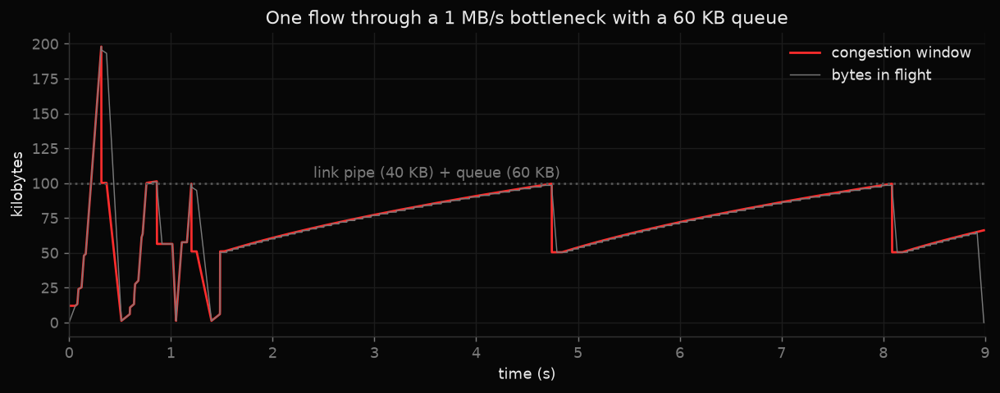
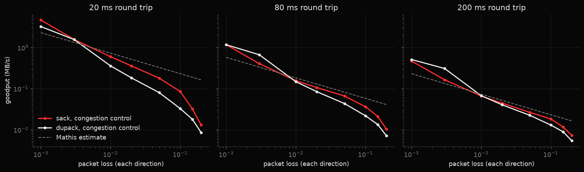

# rudp

A reliable, ordered byte stream on top of UDP, written from scratch in C++20: handshake, sliding window, selective acknowledgements, retransmission timer, congestion control, flow control and a clean close. It runs over real sockets on Windows and Linux, and inside a deterministic network simulator that drops, delays, reorders, duplicates and corrupts packets.

I wrote it to understand what TCP actually does and why, and to be able to test a transport protocol properly: with a simulator you can run the same lossy network a thousand times and get the same answer every time.



The picture above is the protocol working: a flow slow-starts, overshoots the 100 KB the path can hold (40 KB in the pipe plus a 60 KB queue), loses packets, and then settles into the AIMD sawtooth between 50 and 100 KB. That reaches 89 % of the link.

## What it does

| | |
|---|---|
| **Connection** | Three-way handshake with random initial sequence numbers; SYN, SYN-ACK and FIN are retransmitted like data. Graceful close from both sides. Gives up after a configurable number of consecutive timeouts. |
| **Reliability** | 32-bit sequence numbers with wraparound, cumulative ACKs, selective ACKs (up to four blocks), reordering buffer, duplicate suppression, CRC-32 on every packet. |
| **Loss recovery** | A segment is treated as lost when three segments' worth of data above it has been selectively acknowledged (fast recovery), otherwise when the timer fires. With SACK off it falls back to duplicate-ACK counting and NewReno partial-ACK handling. |
| **Timers** | RFC 6298 smoothed round-trip estimate and timeout, exponential backoff that is cleared when new data is acknowledged. RTT is measured from a timestamp echoed in every packet, so retransmissions never confuse the sample. |
| **Congestion control** | Slow start, congestion avoidance, window halving on loss, collapse to one segment on timeout. |
| **Flow control** | The receiver advertises free buffer space; the sender stops when it is zero and probes with a persist timer, so a lost window update cannot deadlock the stream. |
| **Transport independence** | `Connection` does no I/O and never reads a clock. You give it time and datagrams and it hands back datagrams. The same class runs over UDP sockets and over the simulator. |

## Try it

```
cmake -S . -B build
cmake --build build --config Release
ctest --test-dir build -C Release            # 28 tests, about 2 seconds
```

Send a stream across a bad network without leaving your terminal:

```
build/Release/rudp_sim --bytes 4000000 --rtt 80 --loss 0.02 --reorder 0.1 --corrupt 0.01
```
```
result        completed, data intact
time          56.930 s (simulated)
goodput       0.07 MB/s
sender        3506 data segments, 172 retransmitted, 17 timeouts, 124 fast recoveries
receiver      918 out of order, 59 duplicates, 28 bad checksums
network       forward sent 3509, lost 83, queue drops 0, corrupted 28
```

`--log` prints every packet. `--bandwidth`, `--queue`, `--no-sack`, `--no-cc` and `--trace` (writes the congestion window to CSV) are there too.

Real sockets, two terminals:

```
build/Release/rudp_recv 9000 received.bin
build/Release/rudp_send 127.0.0.1 9000 somefile.bin
```

## Results

All numbers come from the simulator with 1200-byte segments. Re-run them with `build/Release/rudp_bench > out/bench.csv` and `python tools/plot.py`.

**Throughput against loss.** The dashed line is the Mathis estimate for a Reno-like sender, `1.22 * MSS / (RTT * sqrt(loss))`. The protocol follows its slope, and SACK pulls ahead of duplicate-ACK recovery as loss rises and several packets are lost in one window.



**Filling a 1 MB/s link** with 40 ms round trip and a 60 KB queue, 8 MB transferred:

| Configuration | Goodput | Retransmitted segments |
|---|---:|---:|
| SACK and congestion control | 0.89 MB/s (89 % of the link) | 219 of 6,886 |
| Duplicate-ACK recovery only | 0.84 MB/s | 222 of 6,889 |
| No congestion control | 0.38 MB/s (38 %) | 30,802 of 37,464 |

Without congestion control the sender overruns the queue and spends most of the link resending what the queue threw away. That is why the window is there.

## What I tested

Twenty-eight tests, all deterministic.

- **Packet format**: CRC-32 check value, round trip, every single-bit flip in a packet is caught, truncated and over-long datagrams are rejected.
- **RTT estimator**: matches the worked arithmetic in RFC 6298, converges, and clamps.
- **Transfers** over simulated networks: clean, 1 to 20 % loss, reordering, duplication, corruption and jitter all at once, 35 % loss during the handshake, a dead link (must give up, not hang), sequence numbers that wrap during the transfer, a slow reader with a tiny receive buffer including lost window updates, and 40 randomly generated networks with random segment sizes and SACK on or off. In every case the received bytes must match exactly.
- **Invariants**: after every simulation step, both connections check their own bookkeeping: the bytes-in-flight counter equals the sum of the outstanding segments, the in-flight segments are contiguous, the retransmission timer is running whenever something is outstanding. This is how the accounting stays honest.
- **Behaviour**: the congestion window grows, then falls after a loss; SACK beats duplicate-ACK recovery under multiple loss; congestion control reduces queue drops; the sender fills at least 75 % of a bottleneck and cannot exceed it.
- **Real sockets**: a 512 KB transfer between two threads over loopback UDP.

## What went wrong along the way

Details in [docs/DESIGN.md](docs/DESIGN.md). The short list:

1. Loss tests that hung for ten simulated minutes. The cause was the RTT estimate exploding to seconds on a 40 ms path, because a segment acknowledged after a long wait for an earlier hole was counted as a slow round trip. Echoing a timestamp in every packet fixed it.
2. Slow start that grew by two segments per round trip, because in the simulator a whole burst arrives at once and produces a single ACK, and I had capped the growth per ACK.
3. The test for a lossy handshake asked for 50 % loss each way, which no TCP would survive either.

## Limits

- One connection per socket pair. There are no connection IDs, so a server handles one client at a time.
- ACKs are not delayed: every received burst gets one ACK straight away. That is simple and fast to recover, and not what you want on a busy link.
- Loss recovery is "mark lost, retransmit once, then wait for the timer". A retransmission that is itself lost waits for the timeout; a real stack would use RACK or a tail-loss probe.
- The congestion controller is Reno-style. There is no CUBIC or BBR, no pacing, and no ECN.
- No encryption or authentication. The CRC protects against corruption, not against an attacker.
- IPv4 only. Not tested on Linux locally; the CI file builds it there with GCC and Clang, with and without sanitizers.

MIT licence.
